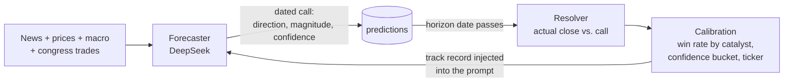
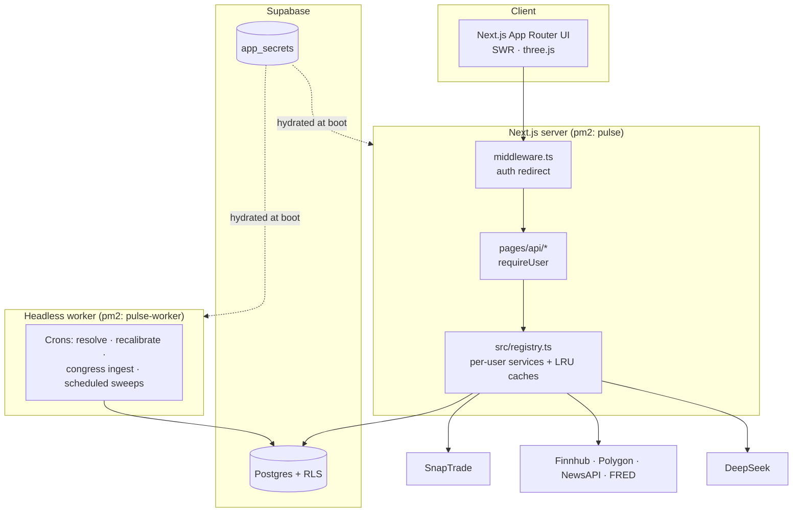

# Pulse

**A multi-tenant portfolio dashboard with an AI forecaster that grades its own predictions.**

Pulse connects to your brokerage, reads the news about what you own, and makes dated directional calls (UP / DOWN / FLAT) on each holding at 1, 7, and 30 days. When each horizon passes, it checks the call against the real closing price, scores it, and feeds that track record back into the next round of forecasts. Over time the system learns which signals it should trust and which it overrates.

<!-- Screenshot / GIF of the /terminal dashboard goes here -->

**Stack:** Next.js 16 · React 19 · TypeScript · Tailwind 4 · Supabase (Postgres, Auth, RLS) · SnapTrade · DeepSeek · three.js · Vitest · pm2 · Electron

---

## What it does

| | |
|---|---|
| **Live portfolio** | Positions and balances from any brokerage SnapTrade supports (E\*TRADE, Schwab, Fidelity, Robinhood, IBKR, …). |
| **News verdicts** | Every story about a holding is classified BUY / SELL / HOLD by an LLM, with the catalyst type (earnings, analyst action, regulation, …) tagged. |
| **Self-scoring forecasts** | 1 / 7 / 30-day directional predictions that resolve automatically and show up on a **Track Record** page. |
| **Congress & insider signals** | Congressional trade disclosures (STOCK Act) and insider activity, matched against your holdings. |
| **3D world view** | A three.js globe that lights up countries by news sentiment tied to your positions. |
| **Agent & alerts** | On-demand or scheduled "sweeps" across the portfolio, a chat interface, and Telegram alerts. |

---

## How the forecaster grades itself

This is the core of the project.



1. **Predict.** For each holding the forecaster gets recent news verdicts, price action, the stock's own realized volatility, macro data, and congressional positioning. It returns a direction, an expected move size, and a confidence score.
2. **Resolve.** A daily job compares each prediction against the close **on its horizon date**, not whenever the job happens to run. "FLAT" is judged against a band scaled to that stock's volatility (ATR·√horizon), so a 1% move in a quiet utility and in a volatile small-cap aren't scored the same way.
3. **Calibrate.** Resolved outcomes roll up into win rates by catalyst type, confidence bucket, and ticker. Catalysts whose real accuracy drifts more than 15 points from what the rules assume get flagged as *trusted* or *downweighted*.
4. **Feed back.** That calibration block goes into the forecaster's prompt, so it sees its own track record before making the next call.

**Changes are tested before they ship.** A candidate forecaster can run in **shadow mode**: its predictions are recorded and resolved but kept out of production scoring. `npm run compare:forecasters` then compares the two on the same tickers and dates. Example: an analysis showed v1 called FLAT about 73% of the time and almost never called DOWN, because the news feed skews roughly 6:1 bullish. The fix (v3) let the model commit to a direction from price and macro alone. In shadow testing it reached 88.9% directional precision on 18 resolved calls (Wilson 95% lower bound 67%) before being promoted. That's a small sample, and the system is built to keep re-checking it as more predictions resolve.

---

## Architecture



### Engineering decisions worth calling out

- **Multi-tenant from the ground up.** Every table is protected by Postgres Row-Level Security (`auth.uid() = user_id`), so tenant isolation is enforced by the database, not just app code. User-facing API routes query with the caller's own RLS-scoped client, and the service-role client is reserved for system jobs.
- **No cross-tenant cache leaks.** Per-user services and caches are built on demand in `src/registry.ts`, keyed `u:<userId>:` and held in an LRU-capped registry. Nothing user-specific lives in a module-level variable.
- **Secrets stay server-side.** API keys live in a service-role-only Supabase table and are loaded into the server's environment at boot (`lib/secrets.ts`). They never reach the browser and never get committed. Users don't need their own API keys: they sign up and link a brokerage.
- **Brokerage credentials are encrypted at rest** with AES-256-GCM at the application layer, with key versioning for rotation (`lib/crypto/`).
- **UI and background work are separate processes.** A small headless worker owns every cron, so the UI can restart, redeploy, or run on a laptop without missing a resolution window. A database-backed lock with heartbeats (`lib/agent/run-lock.ts`) stops a manual sweep in the UI process from overlapping a scheduled one in the worker.
- **Clean-architecture core.** `src/domain/interfaces` defines ports, `src/infrastructure/providers` holds adapters (SnapTrade, or a null broker when none is linked), and `src/services` composes them.
- **Beta safety rails.** Per-user rate limiting, cost caps on LLM-heavy sweeps, and optional Sentry error reporting.

---

## Repo tour

| Path | What's there |
|---|---|
| `app/` | UI routes (App Router): `/terminal`, `/world`, `/hot`, `/agent`, `/track-record`, auth & legal pages |
| `pages/api/` | API routes (Pages Router). App Router for UI and Pages Router for API is a deliberate convention. |
| `lib/agent/` | Sweeps, forecasting (`forecast.ts`), scheduling, cross-process locking |
| `world-brain/` | LLM entry point (`brain.ts`), prediction resolution, calibration, catalyst classification |
| `lib/predictions/` | Prediction persistence |
| `src/` | Domain ports, provider adapters, per-user service registry |
| `scripts/` | CLI entry points: worker, sweeps, backfills, forecaster A/B comparison |
| `supabase/migrations/` | Full schema history, including RLS policies |
| `tests/` | Vitest suite for the forecasting and calibration logic |
| `docs/` | Deeper write-ups: [worker runbook](docs/headless-worker.md), [congress trades](docs/congress-trades-system.md), [recalibration](docs/recalibration.md), [data handling](docs/data-handling.md) |

---

## Running it yourself

You'll need Node 20.19+ (see `.nvmrc`), your own Supabase project, and API keys for DeepSeek, SnapTrade, and Finnhub (Polygon, NewsAPI, and FRED are optional extras).

```bash
git clone https://github.com/IanWolfram/Holdings-Tracker.git
cd Holdings-Tracker && npm install
cp .env.example .env.local
npx supabase link --project-ref <your-ref>
npx supabase db push            # apply supabase/migrations
npm run dev                     # http://localhost:3000
```

**Where the keys go:**
- **`.env.local`** must hold the Supabase connection vars (`NEXT_PUBLIC_SUPABASE_URL`, `NEXT_PUBLIC_SUPABASE_ANON_KEY`, `SUPABASE_SERVICE_ROLE_KEY`). The server needs them to read everything else.
- **Everything else** (DeepSeek, SnapTrade, Finnhub, the encryption key, …) can go in the `app_secrets` table, which is loaded at boot, or in `.env.local`. A value set in `.env.local` always wins.

Sign up, open the Account panel, and link a brokerage through SnapTrade. Until then the portfolio is empty, but news, forecasts, and congress signals still work.

### Running 24/7

```bash
npm run pm2:start               # worker + UI (crons disabled on the UI process)
pm2 save && pm2 startup         # survive reboots
```

Crons should run in exactly one process. A bare `npm run dev` arms them too, so set `PULSE_CRONS=off` on any extra UI instance. See the [worker runbook](docs/headless-worker.md).

### Useful commands

```bash
npm test                        # Vitest
npm run agent                   # full portfolio sweep
npm run resolve:all             # resolve every user's due predictions
npm run recalibrate             # dry-run calibration (--apply to write)
npm run compare:forecasters     # production vs. shadow forecaster A/B
npm run congress:ingest         # pull new congressional trade disclosures
```

---

## Testing

Coverage is intentionally narrow. The suite targets the pure logic of the forecasting loop (outcome scoring, volatility bands, resolution timing, calibration, scheduling, rate limiting) using in-memory test doubles in `tests/helpers/`. UI and third-party adapters are left out on purpose: they change too fast for tests to pay for themselves.

---

## Working with AI agents

[`CLAUDE.md`](CLAUDE.md) is the guide for AI coding agents working in this repo (Claude Code reads it automatically). It covers non-obvious gotchas only, like cron ownership, secret loading, multi-tenant caching, and Supabase's silent 1,000-row cap, so it's also a quick read for human contributors.

---

## Disclaimer

Informational and tracking purposes only. Not financial advice. Pulse never places trades.

## License

A personal project, published to show the work. No license granted. All rights reserved.
